# Fallout 4 — Project Astro-Cosmos / Proyecto Astro-Cosmos
### *Fly Over the Commonwealth (The Hubris Legacy)* — True 3D Superhero Free Flight (`8` Regimes, `714` Havok `.hkx`), Custom 3D PBR Suits & Airborne Arsenal, and *Underground Studio Orbit-7* Voiced Campaign (English & Spanish Standalone Editions)

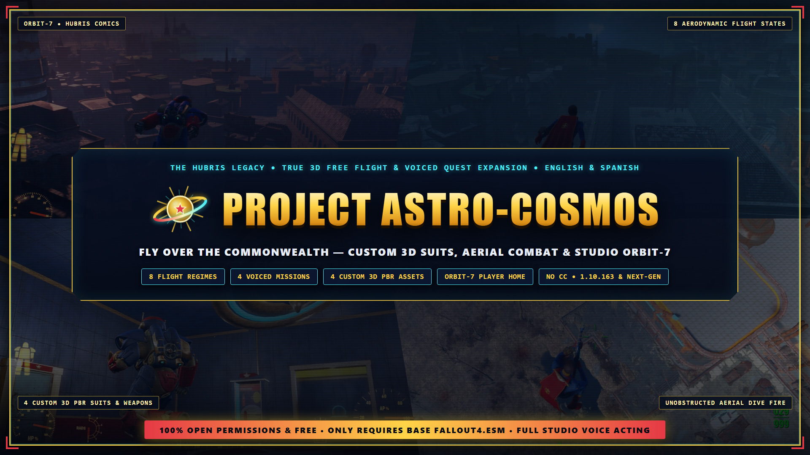

> **🌍 Language Navigation & Direct Downloads / Navegación y Descarga Directa:**
> - 🎬 **[Watch Official Trailer on YouTube / Ver Tráiler Oficial en YouTube (`youtu.be/uGDSPndAUIA`)](https://youtu.be/uGDSPndAUIA)**
> - 📦 **[Download Complete Playable `.zip` Releases (`v1.0.0` — EN & ES)](https://github.com/0utKast/fallout4-project-astro-cosmos/releases)**
>   - 🇺🇸 `ProjectAstroCosmos_EN_v1.0.0.zip` *(146.54 MB — 100% Pure English Standalone Edition for Vortex / MO2 / Manual)*
>   - 🇪🇸 `ProyectoAstroCosmos_ES_v1.0.0.zip` *(157.63 MB — Edición 100% en Español para Vortex / MO2 / Manual)*
> - 🇺🇸 **[English Documentation (Flight Engine, Arsenal, Orbit-7 Quest & Installation)](#english-documentation)**
> - 🇪🇸 **[Documentación en Español (Motor de Vuelo 3D, Arsenal, Misión e Instalación)](#documentación-en-español)**
> - ⚖️ **[Credits & Open Modding Permissions (`CREDITS.md`)](CREDITS.md)** · 📜 **[MIT License (`LICENSE`)](LICENSE)**

---

# 🇺🇸 English Documentation

## 1. Overview
**Project Astro-Cosmos — Fly Over the Commonwealth** (`AeroArmorMod.esp`) is a **100% standalone, dependency-free true 3D superhero free-flight engine, custom 3D PBR arsenal pack, and fully voiced story expansion** for Fallout 4 inspired by Hubris Comics' *Captain Cosmos*.

Discover the **secret hatch outside Hubris Comics** in downtown Boston to unlock **Underground Studio Orbit-7**—a hidden Pre-War 2077 Hubris R&D facility guarded by voiced R&D Director **Dr. Arthur "Artie" Vance** and **Colonel Gutsy "Cosmos"**. Investigate **Clara Sterling's 2077 terminals and holotapes**, pass interactive security exams, soar high above Boston skyscrapers, ArcJet Systems, and Fort Hagen using **8 true 3D aerodynamic flight regimes** (`714` custom 64-bit Havok `.hkx` animations), wield two custom mid-air cosmic weapons with unobstructed `>46°` downward dive fire, and claim **Studio Orbit-7** as a permanent lore-friendly player sanctuary.

---

## 2. Key Engineering & Gameplay Features

| Pillar | What Is Included in `AeroArmorMod.esp` (`v1.0.0`) |
| :--- | :--- |
| 🦸 **True 3D Free-Flight Engine (`8` Regimes, `714` `.hkx` Clips)** | Vertical thruster liftoff, **true stationary mid-air hover** (collision-safe `HoverPlatform.nif` + velocity stabilization), horizontal superhero flight cruise, supersonic sprint, controlled aerodynamic dive/descent, instant ground landing transitions, smoothed 1st-person camera animation (`Track 78` stabilization), and non-destructive **additive subgraph races (`SADD`)** for both Human (`0x01000814`) and Power Armor (`0x01000815`) skeletons—with zero conflicts against other animation mods. |
| 🚀 **4 Custom 3D PBR Suits & Airborne Weapons** | **1. Astro-Cosmos Flight Suit:** Custom cobalt-blue hero suit (`100%` radiation shielding, articulated crimson cape, gloves & `.ssf` skinning). **2. 6-Piece Astro-Cosmos Power Armor:** Repulsion-thruster heavy chassis (`Helmet`, `Torso`, `L/R Arms`, `L/R Legs` + full workbench `OMOD`/`COBJ` support). **3. Astro-Cosmos Ray Carbine:** 3-Prong Atomic Crown Focuser, **6× Observatory Aerial Scope**, unobstructed **`>46°` steep dive-fire** animations in 3rd-person, and **Cosmic Photonic Pulse** (`+25 AP / +15 HP` on 4th hit). **4. Astro-Cosmos Orbital Gauss Cannon:** Quadruple Solar Rail Accelerator, **8× Optics**, unobstructed PA dive-fire, and **Gravitational Supernova** (`+35 AP / +25 HP` on 3rd hit). |
| 🎙️ **Underground Studio Orbit-7 Campaign (`4` Voiced Quests)** | Fully voiced narrative spanning `Underground Studio Orbit-7` (`CELL 0x01002000`), Hubris Comics rooftop, Trinity Plaza, WRVR rooftop, **ArcJet Systems**, and **Fort Hagen**. Includes **`197` lip-synced `.fuz` dialogue files** (Dr. Artie Vance, Colonel Gutsy "Cosmos", Clara Sterling holotapes, and Male/Female player lines) plus **`60` interactive terminal `.wav` exam/alert clips** per language. |
| 🏠 **Permanent Player Sanctuary & Custom Monuments** | Completing the Hubris Legacy campaign turns **Underground Studio Orbit-7** into a complete, permanent base featuring custom retro-comic R&D murals (localized EN & ES textures), the golden **Ringed-Planet Sanctuary** dome, cryo stasis armor bays, safe **Star Chests**, Space Bed (*Well Rested*), and crafting stations. |
| 📦 **All-in-One Binary Package (`BTDX v1` & `HEDR v1.00`)** | Each language edition ships cleanly in **3 files** (`AeroArmorMod.esp` + `AeroArmorMod - Main.ba2` [`1,118` files] + `AeroArmorMod - Textures.ba2` [`90` `.dds` textures]). Verified cleanly with Bethesda's official **`Archive2.exe -extract`** and automated ESP asset resolution (`103/103` custom paths checked, `0` missing). |

---

## 3. Contents Breakdown (`Main.ba2` + `Textures.ba2`)

| Archive / File | Exact Contents (`v1.0.0 EN / ES`) | Size (`EN` / `ES`) |
| :--- | :--- | :--- |
| **`AeroArmorMod.esp`** | `669` records (`HEDR v1.00`, custom FormIDs `>= 0x01000800`, `Fallout4.esm` only) | `2.34 MB` / `2.35 MB` |
| **`AeroArmorMod - Main.ba2`** *(BTDX v1 `GNRL`)* | **`1,118` files**: `714` Havok `.hkx` animations, `47` `AnimTextData` `.txt`, `46` custom 3D `.nif` meshes (+ `3` `.ssf`), `31` PBR `.bgsm` materials, `10` `.pex` + `10` `.psc` Papyrus scripts, `197` lip-synced `.fuz` lines & `60` terminal `.wav` clips | `69.85 MB` / `83.15 MB` |
| **`AeroArmorMod - Textures.ba2`** *(BTDX v1 `DX10`)* | **`90` `.dds` textures** (`DXT1` diffuse/glow & `ATI2` BC5 normal/specular maps, incl. `6` localized EN/ES Orbit-7 comic atlas & director mural textures) | `91.30 MB` / `91.32 MB` |
| **Complete Download Archive (`.zip`)** | Vortex / Mod Organizer 2 ready + `README_EN.txt` / `LEEME_ES.txt` | **`146.54 MB`** / **`157.63 MB`** |

---

## 4. In-Game Screenshot Showcase (`1920×1080`)

| Underground Studio Orbit-7 Rotunda | Voiced R&D Director Dr. Arthur "Artie" Vance |
| :---: | :---: |
| 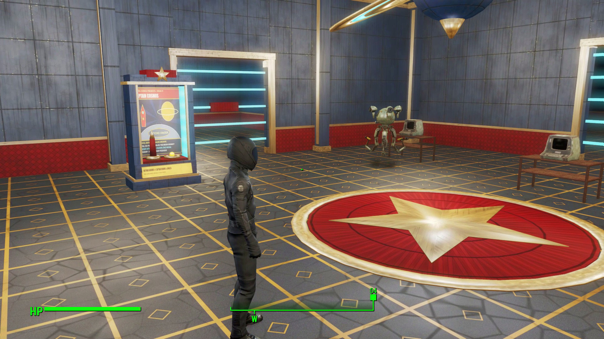 | 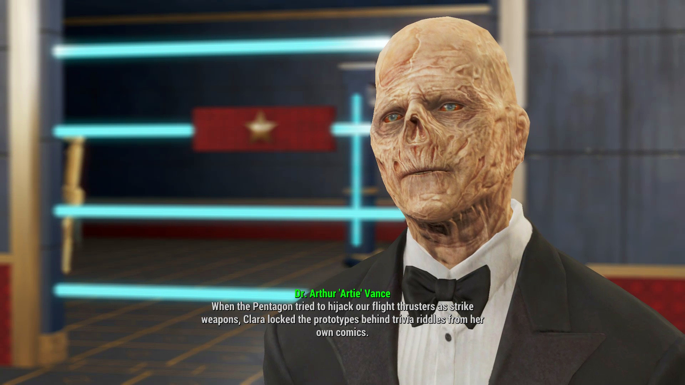 |
| **Custom 3D Astro-Cosmos Flight Suit** | **True 3D Superhero Flight Between Skyscrapers** |
| 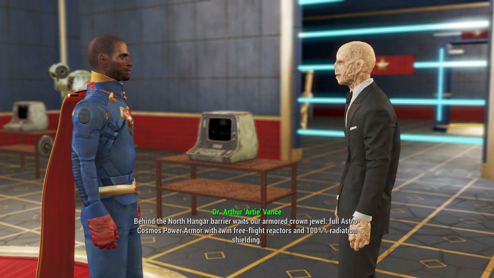 | 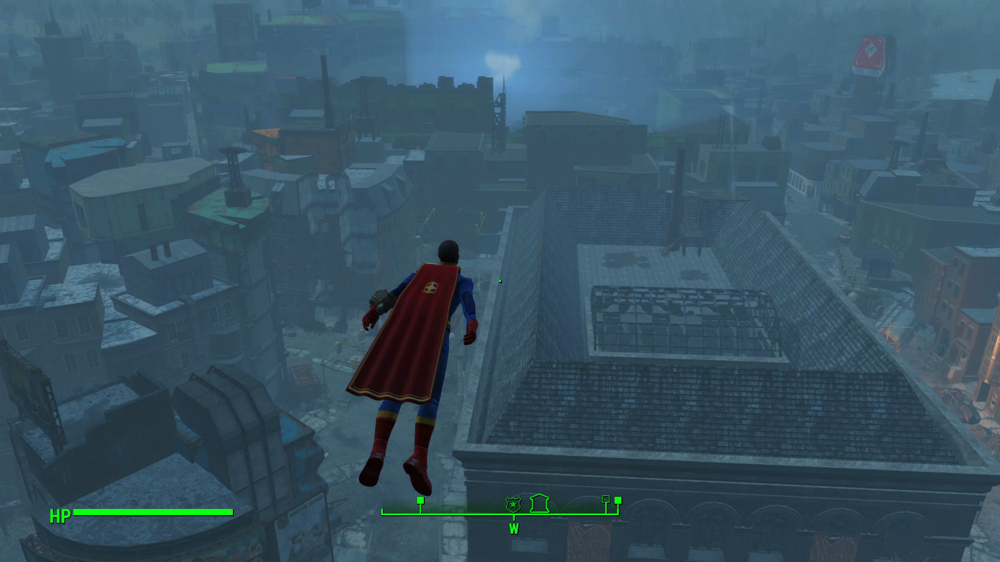 |
| **Astro-Cosmos Ray Carbine (6× Aerial Scope)** | **Unobstructed `>46°` Dive-Fire Over ArcJet** |
| 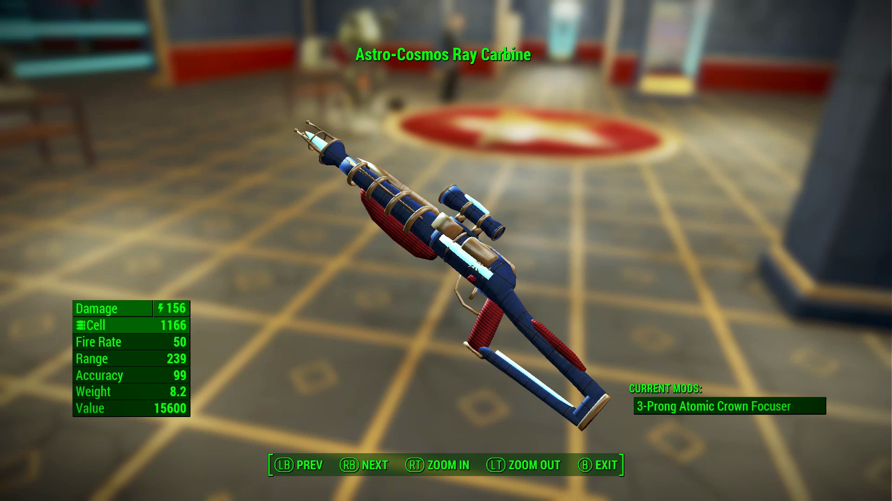 | 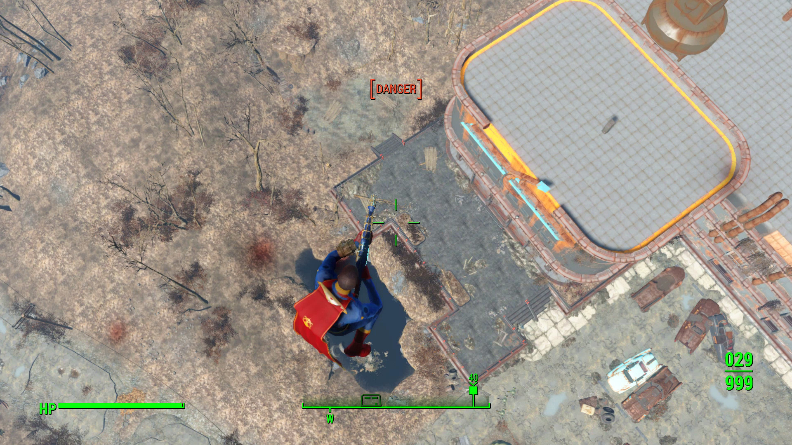 |
| **Golden-Hour Power Armor Skyline Flight** | **Orbit-7 Ringed-Planet Permanent Home** |
| 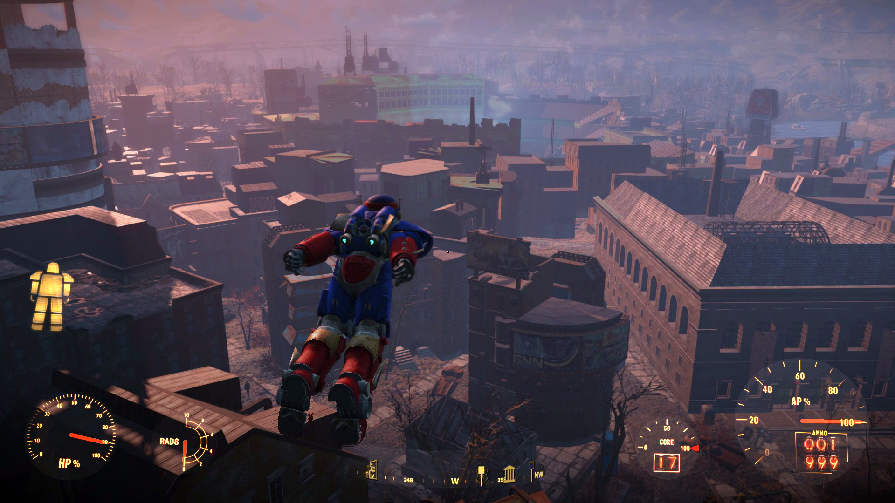 | 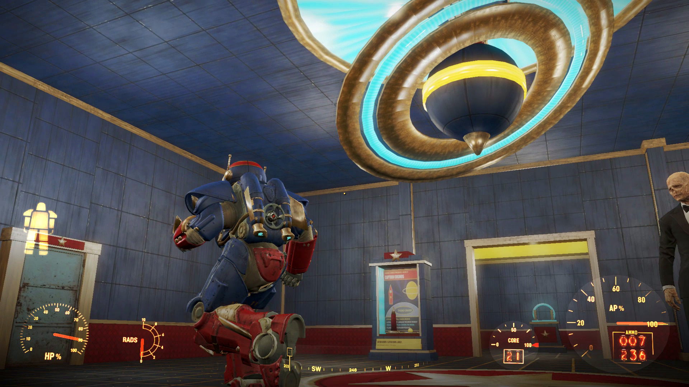 |

---

## 5. Universal Compatibility (`1.10.163` + Next-Gen/AE) & Open Permissions
- **Native Support for Both Game Generations:**
  - **Fallout 4 `1.10.163`** *(Pre-Next-Gen / GOG / Downgraded)*
  - **Fallout 4 `1.10.980+`** *(Next-Gen / Anniversary Edition)*
- **Technical Standards:** `HEDR v1.00` plugin header (`FormIDs >= 0x01000800`) paired strictly with **`BTDX Version 1`** (`GNRL v1` & `DX10 v1`) BA2 archives—no backport patchers needed on `1.10.163`.
- **Zero Lock-In / Zero External Dependencies:** Requires **only base `Fallout4.esm`**. **Zero** Creation Club (`cc*`), **zero** DLCs, and **zero** F4SE required.
- **MIT License & 100% Open Permissions:** Inspect, modify, translate, build upon, or redistribute freely with attribution (`0utKast`).

---

## 6. Installation & Getting Started
1. **Download your standalone edition** from **[GitHub Releases (`v1.0.0`)](https://github.com/0utKast/fallout4-project-astro-cosmos/releases)**:
   - English Edition: `ProjectAstroCosmos_EN_v1.0.0.zip` (`146.54 MB`)
   - Spanish Edition: `ProyectoAstroCosmos_ES_v1.0.0.zip` (`157.63 MB`)
2. **Install via Vortex or Mod Organizer 2** (recommended), or extract `AeroArmorMod.esp`, `AeroArmorMod - Main.ba2`, and `AeroArmorMod - Textures.ba2` into your `Fallout 4\Data` directory and enable `AeroArmorMod.esp`.
3. **Start the Quest:** Travel to **Hubris Comics** in downtown Boston and activate the **Underground Studio Orbit-7** hatch directly outside the main entrance.

---

## 7. Repository Architecture & Reproducible Build Pipeline

```mermaid
flowchart LR
    subgraph ASSETS["1. 3D PBR & Studio Asset Generators"]
        H["generate_cosmos_hero_assets.py\n• Flight Suit, Cape, Gloves & SSF"]
        HW["generate_cosmos_hero_weapon.py\n• Ray Carbine NIF/BGSM/DDS"]
        PA["generate_cosmos_pa_assets.py\n• 6-Piece Power Armor"]
        PW["generate_cosmos_pa_weapon.py\n• Orbital Gauss Cannon"]
        O7["generate_orbita7_studio_assets.py\n• Orbit-7 Architecture & Murals (EN/ES)"]
    end

    subgraph ANIM_QUEST["2. Havok 64-Bit Flight & Quest Compiler"]
        ANIM["build_aero_animations.py + XML\n• 714 .hkx Clips (Human & PA)\n• AnimTextData + Track 78 Smooth"]
        QST["build_hubris_orbita7_quest.py\n+ hubris_orbita7_data_{en,es}.py\n• 197 .fuz + 60 .wav + 4 Quests"]
        ESP["update_aero_esp.py\n• AeroArmorMod.esp (HEDR v1.00, 669 items)"]
    end

    subgraph PKG["3. Packaging & Binary QA"]
        BA2["package_astro_release.py\n• Main.ba2 (BTDX v1 GNRL, 1,118 files)\n• Textures.ba2 (BTDX v1 DX10, 90 DDS)\n• Official Archive2.exe Extract Verification"]
    end

    ASSETS --> ANIM_QUEST --> PKG
```

*Repository layout:*
- [`src/`](src/) — Python 3D asset generators, 64-bit Havok `.hkx` flight compiler, quest/voice builders, EN/ES localization data, and Papyrus `.psc` source scripts (`papyrus_en/` & `papyrus_es/`).
- [`package_astro_release.py`](package_astro_release.py) — Standalone `.ba2` v1 compiler, `Archive2.exe` extraction test suite, and `.zip` release packager.
- [`media/`](media/) — Nexus Mods feature headers (`EN`/`ES`) and curated `1920×1080` gallery screenshots.
- [`release_nexus/NEXUS_DESCRIPTION_BBCODE.txt`](release_nexus/NEXUS_DESCRIPTION_BBCODE.txt) — Ready-to-publish Nexus Mods BBCode overview.

---

# 🇪🇸 Documentación en Español

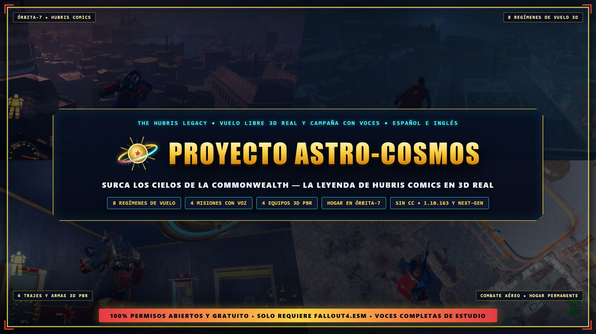

## 1. Descripción General
**Proyecto Astro-Cosmos — Vuela sobre la Commonwealth** (`AeroArmorMod.esp`) es una expansión autónoma para Fallout 4 que implementa un **motor real de vuelo libre en 3D con 8 regímenes aerodinámicos (`714` animaciones Havok `.hkx`)**, **4 equipos/armas 3D PBR originales**, y una **campaña narrativa completamente doblada al español** ambientada en el laboratorio secreto de Hubris Comics (**Estudio Subterráneo Órbita-7**).

Encuentra la escotilla secreta frente a **Hubris Comics** en el centro de Boston para conocer al director de I+D **Dr. Arthur «Artie» Vance** y al **Coronel Agallas «Cosmos»**, investiga los terminales de 2077 y holocintas de **Clara Sterling**, supera los exámenes de seguridad, domina el combate aéreo en picado (`>46°` sin bloqueo de cámara) sobre **ArcJet Systems** y **Fort Hagen**, y desbloquea **Órbita-7** como hogar permanente.

---

## 2. Aportaciones Técnicas y Jugables Principales
- **Motor de Vuelo Libre 3D Real (`8` Regímenes y `714` Clips `.hkx` de 64 bits):** Despegue vertical con propulsores, flotación estacionaria en el aire (`HoverPlatform.nif`), vuelo horizontal de superhéroe, sprint supersónico, picado/descenso controlado, aterrizaje instantáneo, suavizado de cámara en 1.ª persona (`Track 78`) e inyección por **subgrafos aditivos (`SADD`)** para esqueleto Humano y Servoarmadura sin pisar otros mods de animación.
- **4 Equipos y Armas 3D PBR Propios (`46` Mallas `.nif` + `3` `.ssf`, `31` Materiales `.bgsm`, `90` Texturas `.dds`):**
  1. **Traje de Vuelo Astro-Cosmos:** Tejido azul cobalto con inmunidad total a la radiación, emblema solar, capa carmesí y guantes.
  2. **Servoarmadura Astro-Cosmos (6 Piezas):** Propulsores gemelos de repulsión sostenida y mods propios en el taller de servoarmaduras.
  3. **Carabina de Rayos Astro-Cosmos:** Mira aérea `6x`, disparo en picado `>46°` sin obstrucción y **Pulso Fotónico Cósmico** (`+25 PA / +15 Salud` cada 4 impactos).
  4. **Cañón Gauss Orbital Astro-Cosmos:** Acelerador solar cuádruple, óptica `8x` y **Supernova Gravitatoria** (`+35 PA / +25 Salud` cada 3 impactos).
- **Campaña Doblada al Español y Hogar Permanente (`4` Misiones):** **`197` líneas de diálogo con sincronización labial `.fuz`**, **`60` locuciones `.wav` para exámenes interactivos**, texturas localizadas de murales y portadas de Hubris en español, bancos de trabajo y cofres seguros en el **Estudio Subterráneo Órbita-7**.
- **Compatibilidad Universal (`1.10.163` + Next-Gen/AE) y Permisos 100% Abiertos:** Requiere únicamente **`Fallout4.esm`** (`0` Creation Club, `0` DLCs, `0` F4SE), compilado en **`HEDR v1.00`** y **`BA2 v1`** (`GNRL v1` y `DX10 v1`) verificados mediante extracción oficial con `Archive2.exe`.

---

## 3. Instalación Rápida (Español)
1. Descarga **`ProyectoAstroCosmos_ES_v1.0.0.zip`** (`157.63 MB`) desde **[GitHub Releases](https://github.com/0utKast/fallout4-project-astro-cosmos/releases)**.
2. Instálalo con **Vortex** o **Mod Organizer 2** (o copia `AeroArmorMod.esp`, `AeroArmorMod - Main.ba2` y `AeroArmorMod - Textures.ba2` en `Fallout 4\Data`) y activa `AeroArmorMod.esp`.
3. Acércate a la entrada principal de **Hubris Comics** en Boston y entra por la **escotilla secreta del Estudio Subterráneo Órbita-7**.
